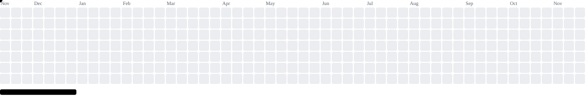

<!-- Troque isaacmaggdev pelo seu nome de usuário do GitHub em TODO o arquivo --> 
    

  

🎮 > player.status
yaml
nome:        Isaac Magalhães
classe:      Game Developer & Pixel Artist
level:       1  # em grind diário
engine:      GameMaker (GML)
arte:        Aseprite
jogos:       1  # Samurai Pong
procurando:  oportunidades no mercado de jogos
🕹️ Projeto em destaque
<table> <tr> <td width="55%"> <!-- Troque pelo GIF de gameplay do Samurai Pong (arraste o GIF numa issue do repo pra gerar o link) -->  </td> <td>

⚔️ SAMURAI PONG Meu primeiro jogo: Pong com tema samurai, feito em GameMaker com arte em pixel no Aseprite.

<!-- Ajuste os tópicos abaixo para o que o jogo realmente tem -->
🏓 Gameplay clássica de Pong
🗡️ Visual samurai em pixel art
🎨 Todos os assets feitos por mim

▶ Jogar no itch.io · 📜 Devlogs

</td> </tr> </table>
🛠️ Inventário

    

📊 Stats

   

👾 Contribuições em modo arcade

 <picture> <source media="(prefers-color-scheme: dark)" srcset="https://raw.githubusercontent.com/isaacmaggdev/isaacmaggdev/output/breakout-contribution-graph-dark.svg"> <source media="(prefers-color-scheme: light)" srcset="https://raw.githubusercontent.com/isaacmaggdev/isaacmaggdev/output/breakout-contribution-graph.svg">  </picture> <picture> <source media="(prefers-color-scheme: dark)" srcset="https://raw.githubusercontent.com/isaacmaggdev/isaacmaggdev/output/pacman-contribution-graph-dark.svg"> <source media="(prefers-color-scheme: light)" srcset="https://raw.githubusercontent.com/isaacmaggdev/isaacmaggdev/output/pacman-contribution-graph.svg">  </picture> 

╔══════════════════════════════════════╗
║   THANKS FOR PLAYING  ·  INSERT COIN ║
╚══════════════════════════════════════╝
 

